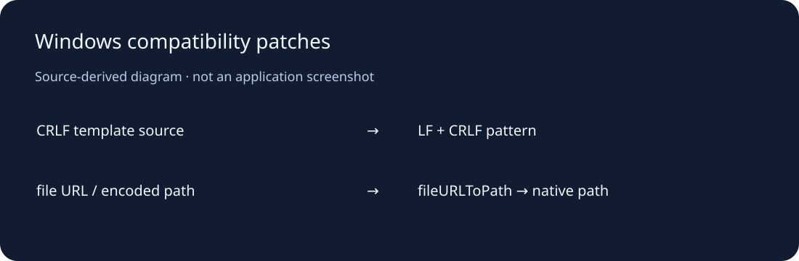

# Personal Homepage Skill · Windows 修补集

为 powerycy 的个人主页 Skill 保存两项小范围本地兼容修正：CRLF 换行下的模板检查，以及 Windows 上含空格/中文的文件URL路径转换。这里交付完整补丁和两个修正后的文件，不将上游模板引擎说成个人原创。



## 使用

需要 Git 与 Node.js24。先克隆[上游项目](https://github.com/powerycy/personal-homepage-skill)，切换至 `4e75c5a0b69ce9d797691a040ea9fb7c8f9db4ac`，再在上游根目录运行（路径换成本仓库实际位置）：

```sh
git apply --check /path/to/homepage-skill-windows-fixes/patches/windows-path-and-newline.patch
git apply /path/to/homepage-skill-windows-fixes/patches/windows-path-and-newline.patch
npm ci
npm run check:templates
npm run build
```

`--check` 不修改文件；确认对应版本后再执行应用。若上游已有同一修复，不应重复应用。也可对照 updated/ 下两份完整文件人工审阅。Skill安装和上游功能以前述项目自己的文档为准；本修补集没有网页服务，不配置虚假的在线应用。

仅验证本修补集的路径/换行逻辑，不需下载上游依赖：

```sh
node scripts/verify-portability.mjs
```

## 范围、验证与目录

- patches/：原工作树两文件的精确Git补丁；updated/：完整修正文件，修改量4增3删。
- scripts/：仅使用Node内置模块的可移植性例子；docs/：源代码示意。
- 本轮用隔离副本的原上游注册表强制CRLF：修补前实际失败“未找到模板”，补丁检查和应用通过，修补后原检查成功；源码和用户现有安装未改。记录见 VALIDATION.md。
- 只验证两处兼容问题，没有重新验收上游全部网站模板、UI/AI流程或依赖安全；不会把兼容补丁称为完整网站开发框架。

## 授权与状态

**派生修补集 / 已验证Windows兼容逻辑。** 上游采用非商业许可，仅适用于其许可允许的个人、学习、研究和作品集用途；保留完整 LICENSE 与 NOTICE，不改授MIT，也不声称整个依赖链符合OSI开源定义。上游模板、提示词、素材与node_modules不随本库。

2026-10-26：整理既有两处改动、补安装步骤与真实回归证据。后续优先向上游反馈并在其修复后淘汰本补丁。原安装仍包含未归档上游资产，当前不建议整目录删除。
